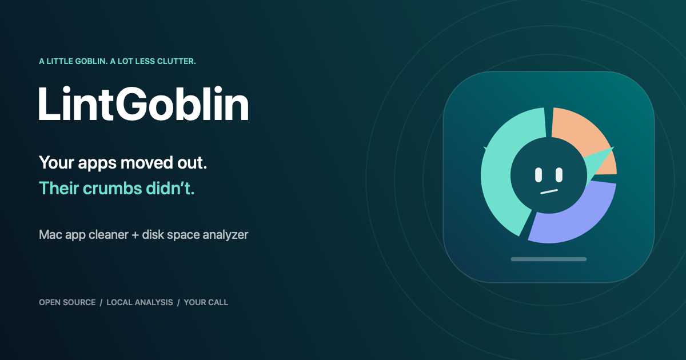
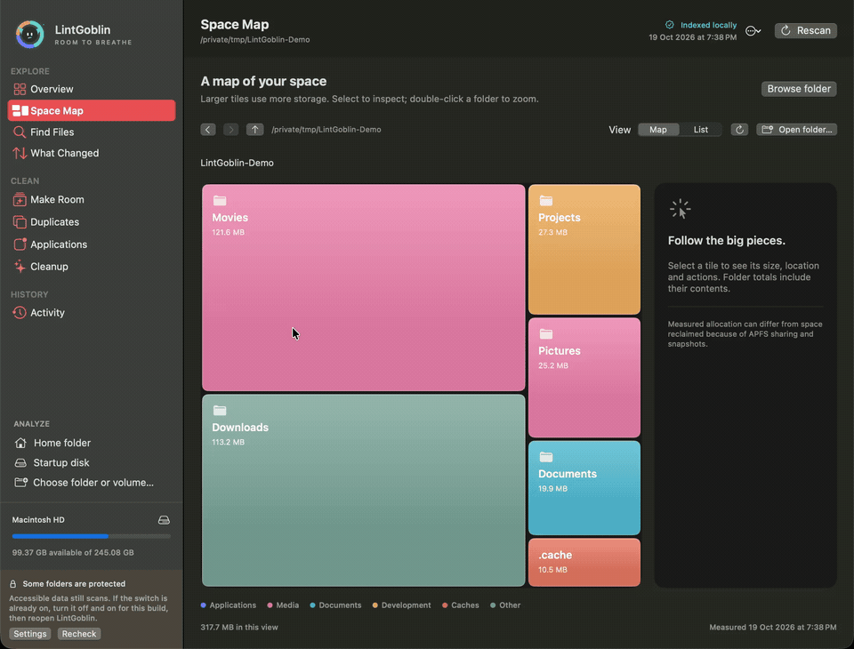

<p align="center"></p>

# LintGoblin — Mac app cleaner & disk space analyzer

**See what’s eating your disk. Inspect the files an app leaves behind. Choose what goes.**

LintGoblin is a free, open-source macOS storage utility: a visual disk usage analyzer, an app uninstaller with connected-file review, and a deliberate cleanup tool in one native SwiftUI app. No accounts, telemetry, uploads, or runtime network access. MIT licensed.

[](https://github.com/everdarksoul/LintGoblin/actions/workflows/verify.yml)
[](LICENSE)
[](#build-and-run)
[](https://github.com/everdarksoul/LintGoblin/releases)

[Latest release](https://github.com/everdarksoul/LintGoblin/releases/tag/v0.5.0-beta.1) · [Build & run](#build-and-run) · [FAQ](docs/FAQ.md) · [Report a bug](https://github.com/everdarksoul/LintGoblin/issues/new/choose)

**0.5 source beta, formerly DiskSense.** Build it locally to try it. A signed, notarized consumer download is still pending; CI packages are development artifacts. macOS 13+ is the app target; automated tests run on macOS 14 and 15.

## Watch the disk, lose the crumbs



A recording of the real app with generated sample files, played at 2× speed and cropped to remove the macOS title-bar controls. [Watch the MP4](docs/media/space-map.mp4). No personal files appear in the demo.

## Two jobs, one Goblin

| What you want to do | How LintGoblin helps |
| --- | --- |
| Find large folders on your Mac | Size-proportional Space Map, folder list, shared navigation and folder chooser |
| Explore another disk or folder | Choose an accessible folder or mounted volume; revisit cached results or rescan for fresh sizes |
| See an app’s connected folders | App bundle, preferences, caches, support data and other possible matches, grouped with per-item Reveal |
| Uninstall an app or remove selected leftovers | Select the bundle and/or connected files, then review every path; related data starts unselected |
| Delete files permanently | Separate irreversible mode, typed `DELETE` confirmation and identity checks; Trash remains the default |
| Find exact duplicate files | Streaming SHA-256 verification of eligible indexed local files, with an unselected copy rechecked before removal |
| Make room toward a target | Editable 1 / 5 / 10 GB cleanup plans from cache and generated-build candidates |
| Understand changes and recover mistakes | Saved-scan comparisons, cleanup receipts and verified restore for items moved to Trash |

## The AppCleaner-style workflow

1. Open **Applications** and find an app.
2. Reveal its bundle or any possible connected folder in Finder. Inspection does not require uninstalling anything.
3. Select only the files you understand. Support data may contain documents, databases or accounts; group containers may be shared.
4. If that app is running, **Ask app to quit** requests a normal quit. Save its work first. Unrelated apps can stay open.
5. **Review removal** shows the paths again. Use Trash for recovery, or explicitly choose permanent deletion and type `DELETE`.

Name and bundle-identifier matches are suggestions, not proof of ownership. Protected system files and managed services are not an automatic cleanup target. Administrator-protected items can be revealed in Finder for macOS authentication; **this beta does not contain a privileged deletion helper**. Full Disk Access grants read access to protected data, not root privileges. [Permissions & removal FAQ →](docs/FAQ.md)

## Small details that matter

- Saved roots reopen without an automatic full rescan. Recent map folders have bounded caches.
- Map and list share back/forward history. Apps & Cleanup refresh independently from folder scans.
- Find files by name, size, type or age; export a local JSON report.
- The animated Goblin opens a compact storage panel; Reduce Motion is respected.
- `⌘O` chooses a folder, `⌘2` opens Space Map, `⌘F` finds files, `⌘K` switches tools, `⌘R` refreshes.

## Cleanup with a clear consequence

Every removal has a separate review. The engine rejects protected roots, the running app and its reviewed connections, ancestor symlink escapes, and changed file identities. Final symlinks are removed as links. Permanent deletion bypasses Trash and has no in-app restore; it is not secure erasure and does not remove backups or APFS snapshots.

Trash operations keep receipts and verify the recorded destination before restore. Restore refuses to overwrite another file. LintGoblin never empties Trash automatically. Partial failures are reported; successful removal is not a promise of immediately reclaimed physical bytes.

Scans measure allocated storage without following symlinks or requesting cloud downloads. Unreadable paths and index limits are reported. APFS clones, snapshots, purgeable space and Trash can make folder totals differ from volume usage. [Measurement and storage details →](docs/STORAGE.md)

## Build and run

Requires macOS and Swift 6. Use macOS 14+ for the Swift Testing suite.

```sh
git clone https://github.com/everdarksoul/LintGoblin.git
cd LintGoblin
./scripts/test.sh
./scripts/build-app.sh
open .build/Distribution/LintGoblin.app
```

Builds produce `.build/Distribution/LintGoblin.app` and `LintGoblin-0.5.0.zip`. Local builds use ad-hoc signing unless `DISKSENSE_SIGNING_IDENTITY` names an existing Developer ID certificate. The internal executable, bundle identifier and `~/Library/Application Support/DiskSense` data directory retain their original names for compatibility.

CI tests and builds on macOS 14 and 15. Regression tests use disposable fixtures and injected operations, covering protected paths, stale identities, running-app checks, symlinks, exact duplicates, index retention and scan lifecycle. Real home folders are never cleaned by the test suite. [Test details](Tests/README.md) · [Production release requirements](docs/RELEASE.md)

## What’s still missing

A signed and notarized consumer installer, a vetted privileged helper, incremental indexing, automatic background cleanup and APFS snapshot management. Related-file matching is heuristic. Index coverage is bounded; search and duplicates cover indexed files only. Choose a smaller root for full coverage. macOS 13 and both CPU architectures still need broader hardware testing before we claim production support.

## Help the Goblin grow

Reproduce a bug with a disposable folder, include the app/OS version, and redact private paths. Useful feedback: folder navigation, permission failures, misleading app connections and cleanup errors. Please do not upload scan databases or personal reports.

[Contributing](CONTRIBUTING.md) · [Security](SECURITY.md) · [Source & artwork provenance](docs/PROVENANCE.md) · [MIT license](LICENSE)
